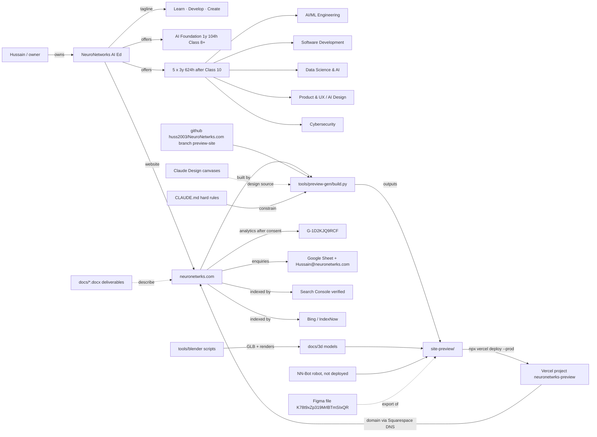

# Knowledge graph (~600 tokens)

## Edge list (grep-friendly)
- program → entry: AI Foundation→Class 8+; all 3-yr→Class 10 pass
- program → hours: AIF 104 (2 h/wk, 52 wk); 3-yr 624 (4 h/wk, 208/yr, 36 monthly modules + 1 h exam each)
- site → host: Vercel `neuronetwrks-preview`; preview URL neuronetwrks-preview.vercel.app
- site → source: `tools/preview-gen` (build.py, site.css, site.js, art.py, guides_pages.py, projects_pages.py)
- site → legacy: Astro scaffold in repo (CLAUDE.md describes Astro/Cloudflare; ACTUAL live site = preview-gen on Vercel)
- domain → DNS: Squarespace (apex A/ALIAS to Vercel, www redirect, Google MX/SPF kept)
- rules → file: `/home/user/NeuroNetwrks.com/CLAUDE.md`, open facts → `docs/open-questions.md`, pending → `docs/launch-checklist.md`
